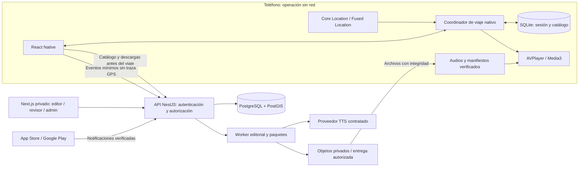

# Audio turismo geolocalizado — primera entrega ejecutiva

**Fecha de corte: 10 de noviembre de 2026 · Mercado inicial: Argentina · Versión 0.1**

**Dictamen: avanzar con una validación acotada; todavía no comprometer una inversión de lanzamiento nacional.** La experiencia es técnicamente realizable durante una sesión iniciada por el usuario. La rentabilidad argentina, la repetición de uso y la fiabilidad en vehículos reales siguen sin demostrarse. Automatización GPS y audio offline ya existen en competidores; la ventaja deberá surgir de la calidad del catálogo, la oportunidad de cada narración y la distribución comercial.

La decisión recomendada es probar **un corredor, una voz, español argentino, 30 historias y ambos sistemas operativos**, con cinco relatos gratuitos descargables. Primero se comprueba una vertical GPS/audio; después se completa el catálogo piloto y se ensaya una compra única por ruta. Un CMS privado mínimo alcanza para esa etapa. La contratación de publicidad, las suscripciones recurrentes, la navegación propia y las interfaces de CarPlay/Android Auto quedan después de las pruebas del núcleo.

**Estado real de esta entrega:** investigación documental, decisiones propuestas, modelo financiero ejecutable y consultas públicas preliminares de nombres. No se construyó una aplicación, no se realizaron recorridos ni entrevistas, no se generó un catálogo históricamente aprobado, no hay compras integradas, proveedores contratados ni permisos de tiendas aprobados. No se hicieron pagos, registros de dominios o contactos con terceros.

## Cómo interpretar los datos

- **Verificado documentalmente:** lo afirma una fuente enlazada, consultada para esta entrega. No equivale a una prueba propia del producto.
- **Hipótesis:** número o decisión de planificación que debe validarse. Las cifras financieras son USD constantes; no se convierten a pesos sin fijar fecha, tipo de cambio y tratamiento fiscal.
- **Propuesto:** diseño pendiente de implementar.
- **Validación externa:** revisión profesional, prueba física, contrato o aprobación que esta investigación no sustituye.

Las páginas de precios pueden variar por país, contrato, volumen, impuestos y canal. Se cita la oferta observada, sin tratarla como cotización garantizada. La evidencia demográfica y de hábitos tiene fechas distintas de la fecha de consulta.

## A. Evaluación de la idea y mercado

### La oportunidad y el verdadero obstáculo

El producto resuelve una tarea concreta: descubrir lo que hay alrededor sin investigar cada parada ni mirar el teléfono. El comprador inicial más prometedor es un grupo que está planificando un recorrido turístico en auto y tiene fecha de viaje. El pasajero puede ser quien descubra, compre y configure la experiencia. La unidad comercial es frecuentemente el vehículo o grupo, aunque la licencia se entregue a una cuenta o dispositivo.

La propuesta de valor recomendada es: **«Historias verificadas que empiezan a tiempo mientras viajás, incluso sin señal».** El beneficio debe demostrarse con una buena primera historia y una descarga terminada, antes de exigir registro o compra.

El principal factor de fracaso sería que el uso fuera demasiado ocasional y que el costo de captar a cada comprador superara la contribución que deja su viaje. Esto puede ocurrir aunque la app funcione perfectamente. El modelo base de esta entrega muestra precisamente ese riesgo: con precio USD 7,99, conversión mensual a compra del 3% y CAC pago de USD 8, el negocio no cubre sus costos en ninguna de las escalas modeladas hasta 500.000 activos mensuales. Es una hipótesis de estrés, no un resultado comercial observado.

### Evidencia disponible y límites

| Pregunta | Evidencia consultada | Lo que permite concluir |
|---|---|---|
| ¿Hay viajes internos y peso del automóvil? | EVyTH: 14,1 millones de turistas en el acumulado del primer semestre de 2024; automóvil 80,6% en Q2; universo residente en grandes aglomerados, 62% de población | Hay un contexto relevante para viajes en auto. No son 14,1 millones de compradores únicos ni una estimación de 2026 |
| ¿Hay estacionalidad? | El mismo tablero informa 10,0 millones en Q1 2024 y 4,1 millones en Q2 | La planificación debe considerar meses de vacaciones y baja. No asumir ingresos constantes |
| ¿Existe una expansión regional plausible? | Brasil informó 20,6 millones de viajes domésticos en 2024 | Es un mercado para estudiar por separado, con portugués, distribución y derechos locales |
| ¿Existe hábito de audio? | SInCA publica ENCC 2022; la presentación pública de 2023 no convierte el relevamiento en datos de 2026 | Sirve como contexto cultural. No identifica disposición a pagar por relatos en automóvil |
| ¿Los turistas argentinos pagarían? | Precios internacionales y oferta local gratuita; no se obtuvo una muestra representativa de compradores argentinos de esta categoría | Debe medirse con precio visible y compra real cuando el producto esté disponible |

Fuentes: [tablero oficial de turismo interno, datos hasta Q2 2024](https://tableros.yvera.tur.ar/interno.html), [Brasil, comunicación gubernamental sobre PNAD Turismo 2024, octubre de 2025](https://agenciagov.ebc.com.br/noticias/202510/aviao-ganha-espaco-viagens-nacionais-brasileiros-supera-onibus), [ENCC, edición 2022](https://www.argentina.gob.ar/node/352013). Confianza alta en lo que esos documentos describen; baja para extrapolarlo al mercado objetivo actual.

No anualizo Q2, no divido mecánicamente por 62% y no sumo visitantes internacionales a compradores nacionales. Llegadas, viajes, personas, vehículos, instalaciones y clientes son unidades diferentes. El informe ETI de INDEC describe turismo internacional, no el mercado doméstico de viajes por carretera. [Referencia metodológica ETI](https://www.indec.gob.ar/uploads/informesdeprensa/eti_07_255132E4AB0E.pdf).

Tampoco uso cifras estadounidenses de podcasts como si describieran Argentina: el Latino Podcast Listener Report 2024 se basa en latinos residentes en EE. UU. El consumo de podcasts o audiolibros no prueba interés por interrupciones contextuales durante la conducción. [Ámbito de la investigación de Edison](https://www.edisonresearch.com/wp-content/uploads/2024/12/Press-Release-Latino-Podcast-Listener-Report-2024-1.pdf).

Queda por medir: apps de mapas/audio que usan los viajeros del corredor, quién decide el audio dentro del auto, tolerancia a interrupciones, uso de datos, conectividad, intención de volver a viajar y gasto aceptable. No asigno porcentajes sin evidencia. Propongo 20 entrevistas con viajeros de fecha próxima, cinco con rentadoras/hoteles y diez observaciones acompañadas por pasajeros. Las entrevistas orientan hipótesis; las compras y sesiones completas deciden.

### Competencia: funciones verificadas y lectura estratégica

Las funciones son declaraciones públicas de sus proveedores; no hice una auditoría de campo. «No verificado» significa que falta evidencia, no que la función esté ausente.

| Producto | GPS/audio/offline verificados | Cobertura e idiomas observados | Precio y modelo observados | Fortaleza | Debilidad u oportunidad inferida |
|---|---|---|---|---|---|
| Autio | Relatos automáticos cercanos y descarga offline | Foco estadounidense; ficha iOS en inglés. No se auditó cobertura completa de Argentina | Referencia anual USD 35,99; la tienda también lista otros productos/precios | Catálogo y narradores reconocibles | Competir con voz célebre resulta costoso; la cobertura local profunda puede ser una oportunidad |
| VoiceMap | Ruta fija, activación automática, descarga de mapa/audio; a pie, auto, bici y barco | Catálogo internacional; idioma y disponibilidad dependen del tour | Guías de publicación permiten USD 5,99–29,99 por tour; hay pases | Herramientas editoriales y distribución de tours | La adaptación a un viaje libre por rutas argentinas requiere contenido y diseño específicos |
| GuideAlong | Autoplay por ubicación y dirección; contenido descargado | El sitio destaca EE. UU., Hawái y Canadá; idioma por tour no auditado | Compra única por tour o paquete; importe específico pendiente de ficha/checkout | Competidor muy directo del viaje en auto | GPS, dirección y offline ya son oferta existente; la diferenciación local debe probarse |
| izi.TRAVEL | Activación GPS exterior y guías offline | Museos/ciudades, contenidos en distintos idiomas | App y sistema anunciados como gratuitos; verificar condiciones de cada contenido | Oferta cultural de baja barrera de acceso | Un catálogo especializado en conducción necesita una experiencia editorial distinta |
| Audioguías institucionales argentinas | Audio descargable; no se verificó un motor vial automático | Parques Nacionales, en las guías publicadas | Acceso público al material; licencia de reutilización comercial por verificar | Confianza institucional y gratuidad | Alternativa gratuita al contenido; potencial socio sujeto a licencia |

Fuentes: [Autio, producto](https://autio.com/), [Autio, ficha App Store EE. UU.](https://apps.apple.com/us/app/autio-road-trip-travel-app/id1300494609), [VoiceMap, funcionamiento](https://support.voicemap.me/how-does-a-voicemap-tour-work/), [VoiceMap, precios de tours](https://docs.voicemap.me/tour-publishers/tour-price/), [GuideAlong](https://guidealong.com/), [izi.TRAVEL](https://izi.travel/es/app), [audioguías de Parques Nacionales](https://www.argentina.gob.ar/node/292813).

Dos precauciones: la home actual de Autio anuncia más historias que una landing promocional antigua, por lo que no uso una cantidad de catálogo como dato estable; una lista de compras de App Store tampoco identifica el producto efectivamente ofrecido a cada usuario. Los precios de VoiceMap para editores son diferentes de los precios al viajero. Su plan Basic anuncia 50% de regalías y planes pagos adicionales: distribuir allí podría servir para probar contenido, con menor control del motor y otra economía. [Condiciones de publicación VoiceMap](https://voicemap.me/pricing).

Los sustitutos también incluyen música, podcasts descargados, mapas y la conversación entre pasajeros. La hipótesis de diferenciación consiste en una **selección editorial breve, argentina, comprobable, anticipada y poco invasiva**, junto con acceso por canales turísticos de bajo CAC. No afirmar «no hay competencia regional» sin un relevamiento exhaustivo de tiendas y operadores.

### TAM / SAM / SOM: modelo explícito, todavía no una medición

Ante la falta de una base actual y deduplicada de grupos que viajan por carretera, uso escenarios de **ocasiones anuales de compra por grupo**. No son usuarios únicos ni una tasación de la industria turística.

`TAM = viajes-persona internos anuales × proporción auto ÷ viajeros por vehículo × elegibilidad digital`

`SAM = TAM × fracción de ocasiones en corredores cubiertos`

`SOM año de prueba = min(SAM, alcance calificado único) × conversión a compra`

Todos los siguientes insumos son hipótesis independientes del tablero histórico:

| Insumo | Conservador | Base | Optimista |
|---|---:|---:|---:|
| Viajes-persona/año | 20 millones | 28 millones | 40 millones |
| Proporción auto | 65% | 75% | 80% |
| Viajeros por vehículo | 2,5 | 2,2 | 2,0 |
| Elegibilidad digital y encaje del viaje | 55% | 70% | 80% |
| Cobertura de corredores | 8% | 12% | 18% |
| Precio de una ocasión | USD 4,99 | USD 7,99 | USD 9,99 |
| Alcance calificado/año | 30.000 | 100.000 | 250.000 |
| Conversión de ese alcance | 1,5% | 3% | 5% |
| TAM, ocasiones | 2.860.000 | 6.681.818 | 12.800.000 |
| SAM, ocasiones | 228.800 | 801.818 | 2.304.000 |
| SOM, compradores esperados | 450 | 3.000 | 12.500 |
| SOM, ventas brutas anuales | USD 2.245,50 | USD 23.970 | USD 124.875 |

TAM/SAM valorados al precio de compra universal son techos mecánicos; los resultados completos están en el anexo financiero. El SAM supone una futura cartera de corredores, no exclusivamente la primera ruta: debe reconstruirse con tráfico turístico, grupos, temporada y cobertura efectiva antes de usarlo para invertir. El alcance del SOM tampoco está contratado ni demostrado. El cálculo de ocupación supone que los viajes-persona se pueden agrupar en vehículos del mismo viaje; falta verificar esa relación en datos reales.

**Sensibilidad base:** la compra neta antes de variables es USD 5,44. Si la conversión del alcance pasa de 3% a 1,5%, SOM e ingresos caen a la mitad. Si la ocupación pasa de 2,2 a 3,0, TAM cae 26,7%. Si se duplica la cobertura pero no el alcance, SOM permanece igual. Si el precio baja 20% sin aumentar conversión, los ingresos caen 20%. Una expansión a Brasil, Chile o Uruguay requiere modelos separados; no sumo estadísticas heterogéneas para inventar un TAM latinoamericano.

## B. Producto ideal, versión comercial y visión

La experiencia ideal comienza antes del viaje. El viajero elige un corredor, escucha una muestra, ve qué incluye y descarga el paquete. La app informa tamaño y verifica que esté listo. Al iniciar, explica el uso de ubicación durante la sesión y comprueba permisos, audio y almacenamiento. El usuario conecta la salida del vehículo mediante las opciones del sistema.

Durante el recorrido, la selección se realiza en el dispositivo. La app guarda silencio cuando no tiene suficiente certeza, cuando ya hay una narración o cuando recibe una interrupción de audio. Un silencio correcto vale más que una historia tarde. El fin del viaje detiene localización y libera audio. El resumen, las fuentes, las transcripciones y el historial aparecen al detenerse; no se exige leerlos para disfrutar de la experiencia.

| Capacidad | MVP de validación | Comercial inicial | Visión posterior |
|---|---|---|---|
| Territorio | Un corredor, ambos sentidos | Pocos corredores con calidad equivalente | Argentina y expansión país por país |
| GPS | Corredor conocido, sesiones explícitas | Viaje libre dentro de zonas cubiertas | Rutas abiertas, mayor personalización |
| Audio | Una voz y duración estándar | Variantes breves/familiares donde aporten valor | Más idiomas y voces validadas |
| Offline | Cinco muestras y paquete piloto | Descargas verificadas, versiones y recuperación | Actualizaciones diferenciales si ahorran costo real |
| Identidad | Invitado, estado local | Cuenta opcional y sincronización | Compartir experiencias, con privacidad |
| Monetización | Precio visible y experimento; compras reales después del núcleo | Compra por ruta con restauración | Suscripción si hay repetición; B2B probado |
| Operación | CMS/admin privados mínimos | Soporte, auditoría, compras y métricas | Portal de socios y campañas |
| Automóvil | Audio por salida compatible y controles permitidos | Robustez validada en vehículos | CarPlay/Android Auto si califican y se aprueban |

El ideal de personalización no debe convertir una historia en contenido improvisado por IA en cada paso. El contenido aprobado y sus reglas se versionan juntos.

## C. MVP óptimo y experimento económico

**Corredor propuesto:** RN 68, Quebrada de las Conchas, con un alcance inicial delimitado por levantamiento de campo. La ruta escénica está documentada oficialmente. Todavía no están verificados el trazado digital que se utilizará, los puntos concretos de activación ni su idoneidad para narrar en curvas o accesos. No presento coordenadas ni distancias del piloto como aprobadas. [Referencia territorial oficial](https://www.larutanatural.gob.ar/es/ruta-escenica/16/quebrada-de-las-conchas-rn-68).

La elección combina narrativa visual, concentración geográfica y necesidad de funcionamiento sin señal. La conectividad deficiente y el relieve también la vuelven exigente. Si no hay un colaborador local y capacidad de recorrerla, se debe elegir un corredor accesible para el equipo; la posibilidad de repetir pruebas pesa más que el atractivo del destino.

**Alcance funcional:** cinco relatos gratuitos y objetivo de 25 adicionales, descarga y verificación, localización durante sesión, selección por segmento/sentido/ETA, una sola reproducción, pausa/salto/silencio, fin de viaje, historial local, fuentes, errores claros y herramienta interna de simulación. La primera prueba técnica usa diez puntos y audios sintéticos expresamente identificados; no se publican como turismo real.

**Experimento de validación en dos pasos:**

1. **Demanda antes del desarrollo amplio:** página de investigación con fecha/estado del piloto claramente visibles, una muestra autorizada y precio asignado USD equivalente 4,99 / 7,99 / 9,99. Tráfico acotado a personas con viaje próximo. El botón registra interés informado; no dice que la app se puede descargar si no existe. No es evidencia de pago. Presupuesto propuesto: USD 600 en anuncios, dentro de un tope total de USD 3.900 para entrevistas, investigación, creatividad, asesoramiento y logística. No se inició ninguna campaña.
2. **Compra y experiencia tras superar la prueba técnica:** beta distribuida por canales permitidos y posterior compra real por tienda cuando esté habilitada. Objetivo inicial de aprendizaje: 30 grupos con sesión real, 15 compras no incentivadas y segunda cohorte de al menos 300 visitantes calificados al precio ganador. Registrar origen, elegibilidad, activación, compra, reembolso y costo por comprador. No usar pagos de sandbox como demanda.

Los tamaños anteriores detectan problemas grandes; no demuestran significación estadística de pequeñas diferencias. Con 15 compras no se puede afirmar que USD 7,99 gane por pocos puntos a USD 9,99. Si falta potencia, ampliar muestra al precio final y documentar intervalos de confianza; no declarar un ganador por ruido.

**Puertas de inversión propuestas:** al menos 70% de grupos que descargan la muestra inicia una sesión completa; valoración mediana ≥4/5; ≥80% califica la frecuencia como adecuada; captación pagada por comprador ≤USD 2,50 o un canal aliado con economía equivalente. El umbral CAC surge de la contribución conservando el costo de usuarios gratuitos en el modelo base; debe recalcularse con datos. Una conversión baja después de una buena experiencia, o demanda rentable solo con descuentos muy altos, obliga a cambiar oferta/canal antes de ampliar el catálogo. La captación de interesados es un filtro previo, no reemplaza esta puerta.

## D. Arquitectura recomendada

### Decisiones

| Área | Elección propuesta | Razón y alternativa |
|---|---|---|
| Móvil | React Native + TypeScript, development builds; Expo para partes compatibles | Una interfaz compartida; Swift/Kotlin para operación crítica. Expo Go no valida background. Nativo completo si las mediciones justifican asumir dos interfaces |
| Ejecución de viaje | Coordinador nativo en cada plataforma, persistencia local; referencia de reglas en TypeScript para simulación | No depender de un temporizador JS ni de la pantalla abierta. Contratos y vectores de conformidad comunes evitan divergencias de reglas |
| Datos locales | SQLite, índice espacial simple/segmentos y archivos por hash | Activación sin red, transacciones y recuperación. Un índice sofisticado solo cuando lo exija el catálogo |
| API | NestJS/TypeScript, REST/OpenAPI; monolito modular | Módulos de catálogo, editorial, paquetes, identidad y compras. No hay necesidad inicial de microservicios |
| Base de datos | PostgreSQL + PostGIS administrado | Entidades editoriales y consultas espaciales; migraciones SQL para GIS. ORM en datos comunes, sin forzar la capa espacial |
| Admin/editorial | Una aplicación privada Next.js, TypeScript y componentes reutilizables | Dos áreas/roles dentro de una herramienta, en lugar de construir dos productos duplicados |
| Publicación web | Next.js, páginas editoriales y de producto | Desplegar al existir oferta verificable. La web comercial no reemplaza a la app |
| Audio | Archivos preproducidos; AVPlayer en iOS; Media3 en Android | Validar voz, licencias y convivencia antes de elegir un wrapper RN definitivo |
| Objetos | S3 compatible; candidato R2, dominio propio y autorización para activos premium | Archivos inmutables, hashes y distribución separada de la API. Sin secretos en cliente |
| Trabajos | Tabla de jobs + worker idempotente inicialmente | Síntesis/QA/publicación no bloquean HTTP. Redis/cola dedicada al medir carga o necesitar garantías mayores |
| Infraestructura | API/worker en hosting administrado, PostgreSQL administrado, CI | Presupuesto bajo y recuperación documentada; proveedor definitivo tras cotizar región y backups |

Expo documenta requisitos y límites de localización en segundo plano; su configuración puede pedir permisos más amplios que un módulo nativo ajustado al caso. Se probará el camino mínimo de sesión iniciada en primer plano antes de aceptar esa dependencia. [Documentación Expo Location](https://docs.expo.dev/versions/v58.0.0/sdk/location/).

La especificación de reglas tendrá versión explícita. El simulador TS y ambos ejecutores nativos procesarán los mismos fixtures y deberán producir las mismas decisiones. Mantener tres evaluadores cuesta trabajo; se limita el primer algoritmo a filtros y puntuación simples. No se promete compartir automáticamente código TS dentro de procesos nativos suspendidos. El puente transporta comandos y snapshots; el coordinador conserva la autoridad sobre sesión, exclusión de reproducciones y checkpoints.

### Infraestructura y fronteras de confianza



El diagrama describe una arquitectura propuesta, sin recursos aprovisionados. Los servicios de mapas no deciden cada activación. Los datos precisos GPS permanecen locales por defecto. La API recibe eventos minimizados cuando vuelve la red.

### Mapas, licencias y ruteo

| Opción | Uso recomendado y límites | Decisión |
|---|---|---|
| Mapbox | SDK móvil con soporte de mapas offline; precios separados según servicio y condiciones del SDK | Candidato si el mapa offline resulta necesario; validar costo, wrapper RN y términos de ruteo/almacenamiento |
| Google Maps/Routes | Buen ecosistema; las políticas de Routes restringen almacenamiento y la mezcla de resultados con otros mapas | No usar su contenido como base permanente redistribuible del motor offline sin licencia que lo permita |
| MapLibre + datos OSM con proveedor contratado o generación propia | Más control sobre mapas/datos; hosting, atribución, ODbL y operación requieren trabajo | Preferencia para evolucionar un catálogo propio y portable; no montar un servidor de tiles durante el primer spike |

MapLibre es un renderizador, no una fuente gratuita e ilimitada de mapas o rutas. El servicio público `tile.openstreetmap.org` prohíbe la descarga masiva/offline; no se usará como backend comercial de paquetes. [Política OSM](https://operations.osmfoundation.org/policies/tiles/). Mapbox documenta su [soporte offline](https://docs.mapbox.com/help/dive-deeper/mobile-offline/) y [tarificación](https://www.mapbox.com/pricing). Google publica [precios por SKU](https://developers.google.com/maps/billing-and-pricing/pricing) y [restricciones de Routes](https://developers.google.com/maps/documentation/routes/policies).

Para el MVP se prepara un corredor geográfico licenciado y verificado, y un esquema estático de recorrido. No se requiere mapa de navegación ni búsqueda mundial. La selección origen/destino libre se incorpora cuando haya un proveedor contratado y reglas claras de persistencia. No se dibuja una ruta de un proveedor sobre el mapa de otro sin comprobar las condiciones.

### Modelo de datos y API iniciales

Entidades mínimas: `Corridor → RouteVersion → RouteSegment`; `PointOfInterest → Story → StoryVersion → Translation/Script`; `AudioAsset`, `Source`, `License`, `ActivationRule`, `EditorialReview`, `PackageManifest`, `User/AuthAccount`, `Purchase`, `Entitlement`, `ConsentRecord`, `AuditLog`. Las sesiones, descubrimientos y progreso viven primero en SQLite; solo se sincronizan si hay una finalidad y una preferencia explícitas.

PostGIS: puntos `geography(Point,4326)` y líneas con SRID declarado; índices GiST para preselección espacial; claves de versión inmutables y unicidad de número de versión por historia. Coordenadas de origen, licencia y revisión obligatorias para publicar. Distinguir posición del lugar y **ancla vial de narración**: pueden ser diferentes. La distancia geodésica sirve para prefiltrar; el criterio final usa progreso sobre el segmento dirigido y contexto del corredor.

Contratos propuestos, con validación de esquema y errores explícitos:

| Endpoint | Finalidad / autorización |
|---|---|
| `GET /v1/catalog/corridors` | Catálogo público paginado, solo versiones publicadas |
| `GET /v1/packages/{id}/manifest` | Manifiesto firmado; autorización de descarga según producto |
| `POST /v1/download-authorizations` | URLs temporales para activos; comprueba entitlement |
| `POST /v1/admin/stories/{id}/reviews` | Revisor, comentario y control de versión concurrente |
| `POST /v1/admin/releases` | Publicador, validación integral y auditoría; no publicación directa por IA |
| `POST /v1/purchases/verify` | En fase comercial; verifica transacción con tienda, idempotencia |
| `POST /v1/webhooks/apple` y `/google` | Firmas/autenticación, deduplicación, reconciliación de estado |
| `POST /v1/events/batch` | Esquema cerrado, límite de tamaño, eventos sin coordenadas exactas |
| `DELETE /v1/account` | Cuenta autenticada, confirmación de identidad y borrado programado verificable |

Las rutas son diseño, no endpoints existentes. Roles: autor, revisor, publicador, soporte y administrador; solo soporte no puede publicar ni conceder compras. El cliente no modifica entitlements ni accede directamente con credenciales privilegiadas a la base de datos.

## E. GPS, audio, offline y pruebas técnicas

### Activar por contexto, no por un círculo

Cada muestra contiene posición, precisión horizontal, hora, velocidad y rumbo con su calidad. Se descartan muestras antiguas, saltos físicamente incoherentes y precisión insuficiente. La velocidad se suaviza sin borrar cambios reales; a baja velocidad no se toma el rumbo como confiable. La posición se proyecta sobre segmentos dirigidos del corredor, respetando continuidad temporal. En cruces y paralelas se conserva ambigüedad hasta reunir evidencia suficiente.

Flujo propuesto: `muestra válida → segmento probable → candidatos por delante → filtros duros → ventana temporal → ranking → reserva atómica → audio disponible → foco concedido → reproducción`. Si falla un requisito, se espera o descarta. No se compensa una ruta equivocada con prioridad editorial alta.

**Filtros duros:** versión publicada, fuente/licencia/coordenadas revisadas, segmento y sentido compatibles, audio íntegro local, no escuchada/omitida en esa sesión, permiso y sesión activos, precisión aceptable, ausencia de conflicto conocido y punto todavía oportuno. Un cambio de ruta invalida la cola; antes de reproducir se reevalúa la elegibilidad.

**Anticipación:** calcular distancia por el trazado hasta el ancla y dividir por velocidad filtrada solo como primera aproximación. El scheduler busca una ventana en la que la historia pueda comenzar con contexto y finalizar antes de perder relevancia. Para 60 segundos a 100 km/h, el vehículo recorre aproximadamente 1.667 metros; con un margen inicial hipotético de 15 segundos, la distancia es 2.083 metros. No es un radio universal: cambios de velocidad, curvas, restricciones de sentido y maniobras afectan la oportunidad. Si ya no cabe, usar una variante breve aprobada o saltar; no narrar automáticamente sobre un punto dejado atrás.

**Ranking después de los filtros:** `0,30 × oportunidad temporal + 0,25 × relevancia editorial + 0,20 × interés + 0,15 × calidad editorial + 0,10 × diversidad`. Variables normalizadas a [0,1], fórmula/versionado auditables y desempate estable. No interpretar «calidad» como certeza de una afirmación falsa: cualquier contenido no aprobado queda excluido antes del ranking. Pesos y umbrales se calibran en ruta, sin modelos de IA opacos en el MVP.

| Parámetro inicial propuesto | Valor para probar | Política al incumplir |
|---|---|---|
| Antigüedad máxima del fix | 10 s | No iniciar un relato nuevo |
| Precisión horizontal | ≤35 m; entre 35–75 m, degradado; >75 m, suspendido | En rutas paralelas puede requerirse mayor precisión o esperar |
| Velocidad para inferir dirección | >3 m/s con varias muestras coherentes | Por debajo, no inventar sentido |
| Detención | <1,5 m/s durante 20 s | No iniciar nuevas narraciones; audio actual puede terminar según contexto |
| Ventana objetivo | Duración + 10–25 s de margen | Recalcular según tramo y velocidad |
| Cooldown | 180 s desde fin de audio | Reservar silencio y posponer candidatos |
| Frecuencia | Máximo objetivo de 6 relatos por hora | Es un techo, no una cuota obligatoria |
| Desvío de corredor | >80 m durante 3 fixes válidos, solo si la precisión lo permite | Degradar/invalidar; umbral diferente según ancho y geometría |
| Recuperación | 3 fixes coherentes | Recalcular, sin vaciar de golpe una cola atrasada |

Estos números no son recomendaciones universales ni resultados de calibración. No usar 80 m para decidir una carretera paralela a 20 m: la incertidumbre exige no activar. El modo libre inicial se limita a corredores descargados; fuera de ellos informa falta de cobertura y permanece en silencio.

### Máquinas de estados y recuperación

Viaje: `inactivo → preparando → listo → activo`; desde activo: `pausado`, `GPS degradado`, `interrumpido` o `finalizando → finalizado`. Cada evento tiene ID, hora y causa. Revocar permiso detiene actualizaciones y nuevas activaciones; terminar cancela listeners, jobs y reservas.

Reproductor: `idle → preparado → solicitando foco → reproduciendo → completado`; ramas `pausado por usuario`, `interrumpido`, `fallido`, `omitido`. Solo una instancia puede poseer la reserva de reproducción. Perder foco, desconectar salida o recibir interrupción pausa; recuperar foco no anula una pausa manual ni reanuda una historia ya inoportuna.

Historia por sesión: `no elegible → próxima → preparada → en cola → reproduciendo → escuchada`; salidas `omitida` o `descartada por cambio de ruta`. Marcar escuchada al umbral propuesto de 90% o final natural; guardar también progreso real para distinguir escuchas parciales. Si varias historias compiten, la cola máxima inicial es una y se reevalúa al liberarse.

Persistencia transaccional local: sesión, reglas/versiones, historia reservada, cursor y preferencias. Checkpoints cada 5 s de audio y en cambios de estado. Tras cierre del sistema se reconstruye el estado y se pide ubicación fresca antes de decidir. Tras cierre forzado por el usuario o reinicio, no se promete continuar narrando sin reabrir/reiniciar de manera permitida. Geofencing puede ayudar a preseleccionar o ahorrar energía; no garantiza precisión temporal para disparar un audio a velocidad de carretera.

### Capacidades y límites de plataforma

| Capacidad | iOS | Android |
|---|---|---|
| Posición durante sesión explícita | Core Location; configurar background y autorización adecuada; APIs de sesión según OS objetivo | Servicio foreground de ubicación iniciado con app visible; permiso de localización concedido |
| Pantalla bloqueada | Audio/background y localización son permisos/capacidades diferentes | Servicio de ubicación y sesión multimedia con tipos/permisos declarados |
| Audio | AVPlayer + AVAudioSession; interrupciones y cambios de ruta | Media3/ExoPlayer + MediaSessionService; audio focus |
| Controles del sistema | Now Playing y MPRemoteCommandCenter | MediaSession y notificación multimedia |
| Cierre o restricciones del sistema | Estado recuperable, sin garantía de ejecución continua o relanzamiento tras force quit | Restricciones por versión/fabricante; no reiniciar todo desde boot para eludirlas |

Apple documenta sesiones de ubicación en background y autorización requerida; no presupongo que «Always» sea necesario para todas las variantes nativas de una sesión visible iniciada por el usuario. El permiso mínimo se decide con la API y versión elegidas. [Core Location](https://developer.apple.com/documentation/corelocation/handling-location-updates-in-the-background?changes=latest_maj_8__2&language=objc).

Android distingue tipos `location` y `mediaPlayback`; desde Android 14 hay requisitos explícitos por tipo. No solicitar `ACCESS_BACKGROUND_LOCATION` por defecto si basta una sesión foreground iniciada correctamente; si se necesita, justificar su uso y pasar la revisión correspondiente. [Tipos de foreground service](https://developer.android.com/develop/background-work/services/fgs/service-types), [acceso de Fused Location](https://developers.google.com/android/reference/com/google/android/gms/location/FusedLocationProviderClient), [política de Google Play](https://support.google.com/googleplay/android-developer/answer/9799150?hl=en).

**Convivencia de audio:** en iOS, ensayar `.playback`/`.spokenAudio`, ducking cuando corresponda y desactivar la sesión al terminar para permitir recuperación externa. No activar indiscriminadamente `interruptSpokenAudioAndMixWithOthers`: puede interrumpir otra app hablada, lo que contradice la prioridad deseada de navegación. [Modo spokenAudio](https://developer.apple.com/documentation/avfaudio/avaudiosession/mode-swift.struct/spokenaudio), [opción para interrumpir audio hablado](https://developer.apple.com/documentation/avfaudio/avaudiosession/categoryoptions-swift.struct/interruptspokenaudioandmixwithothers?changes=la).

Android exige comprobar concesión de foco y abandonar el foco al finalizar; desde target Android 15 la solicitud requiere estar en primer plano o ejecutar un foreground service. Ensayar foco transitorio sin tratar narraciones de 90 segundos como avisos de navegación prioritarios. [Audio focus](https://developer.android.com/media/optimize/audio-focus). El servicio multimedia y los controles están documentados por [Media3](https://developer.android.com/media/media3/session/background-playback?authuser=482) y [Apple MediaPlayer](https://developer.apple.com/documentation/mediaplayer/handling-external-player-events-notifications?changes=late_2).

**Límite decisivo:** no existe una garantía general de conocer cada próxima indicación de Waze/Maps o de detectar audio que otra app mezcla sin notificar una interrupción. No se promete «nunca tapa una indicación». Política: ceder ante señales disponibles, suspender ante conflicto, zonas locales de silencio antes de cruces conocidos y pruebas de combinaciones declaradas compatibles. Si una combinación solapa voces y no se puede resolver con APIs permitidas, no se habilita narración automática en esa combinación. Tampoco se controla la cuenta de Spotify, Apple Music o YouTube Music; el restablecimiento del audio previo depende del SO y de la otra app.

### CarPlay, Android Auto y seguridad

1. Bluetooth/USB transporta audio a una salida compatible; no concede una interfaz propia en la pantalla del auto.
2. Bloqueo de pantalla exige una sesión de audio y una sesión de ubicación válidas; no equivale a CarPlay.
3. Controles multimedia se exponen por APIs del SO; no garantizan un botón dedicado en cada vehículo.
4. CarPlay requiere categoría/entitlement y revisión. Audio parece un encaje a evaluar, no aprobado. [Entitlements Apple](https://developer.apple.com/documentation/carplay/requesting-carplay-entitlements).
5. Android Auto media y las categorías de Car App Library tienen condiciones diferentes. Se evaluará primero media; una categoría POI no es un atajo para dibujar cualquier interfaz. [Categorías Android for Cars](https://developers.google.com/cars/design/create-apps/app-types/overview), [apps POI](https://developer.android.com/training/cars/apps/poi?authuser=50&hl=en).
6. Convivir con navegación externa no concede acceso a su ruta, maniobras o estado interno. Navegación propia es otro producto, con motor, mapas, operación y responsabilidades adicionales.

La app se configura antes de circular; no recomienda maniobras ni desvíos improvisados. No hay banners, anuncios visuales, enlaces de compra ni lectura obligatoria durante la sesión. El modo de viaje reduce controles y posterga tareas; una detección de movimiento no sustituye la decisión responsable del usuario ni es una garantía de seguridad vial. Las pruebas se observan desde el asiento de pasajero.

### Offline: capacidad esencial desde el piloto

Un paquete contiene versión de esquema, ID/versión de corredor, licencia, geometrías autorizadas, anclas/sentidos, reglas, guiones, fuentes, audio por idioma, tamaños y SHA-256. El manifiesto se firma en servidor y el cliente verifica con una clave pública; el hash solo no prueba quién publicó el archivo.

Descargas a archivos temporales, reanudación por `Range` y ETag si el servidor lo permite; validación por activo y commit atómico del paquete completo. Conservar la versión anterior hasta terminar el commit, comprobar espacio para ambas versiones y limpiar temporales. Si hay corrupción, no reproducir el activo; reparar ese archivo al volver la red. No usar una mezcla accidental de audio viejo y reglas nuevas.

Preferencia Wi-Fi, límite de almacenamiento configurable, borrado explícito y política LRU que no borre el paquete del viaje activo. La versión inicial actualiza activos por hash, sin crear un sistema complejo de parches binarios. Iniciar viajes nuevos solo con paquete usable; una descarga incompleta no se anuncia como lista.

Para compras por ruta, una prueba firmada persistida permite acceso offline ya autorizado; reembolsos se aplican al reconciliar. No se puede revocar instantáneamente un archivo de un dispositivo sin red. Si se incorporan suscripciones, diseñar una licencia temporal firmada con ventana offline declarada y nunca bloquear una narración en medio de la conducción para exigir login. Ofuscación/cifrado de archivos puede aumentar costo de extracción, no eliminar la copia por completo.

## F. Contenido, IA y producción sonora

El activo principal será el conjunto **guion + evidencia + voz + licencia + regla de activación verificada**. No basta con generar un texto plausible.

Pipeline: identificación del lugar → fuentes y licencia → comprobación de coordenadas/ancla vial → guion → revisión factual y cultural → adaptación oral → pronunciación → síntesis o locución → QA sonora → revisión separada → publicación versionada → evaluación en campo → mantenimiento. Los estados CMS serán borrador, investigación, revisión, aprobado, publicado, suspendido y archivado. Aprobar un guion no autoriza publicar un audio o una coordenada que cambiaron después; cualquier modificación relevante invalida su aprobación.

Cada versión registra autor, revisor, fechas, idioma, duración real, fuentes por afirmación relevante, URL/página/fecha consultada, licencia y atribución, grado de confianza, pronunciaciones y evidencia de geoverificación. Leyendas deben anunciarse como tradición o relato, sin presentarlas como hechos. Una fuente oficial de promoción turística puede orientar, pero no sustituye la investigación de una afirmación histórica controvertida.

Usar fuentes primarias, archivos, museos, publicaciones académicas y especialistas locales. No copiar Wikipedia, imágenes de Maps o textos de terceros como si fueran libres de derechos. Verificar licencias de textos, fotografías, mapas, voces y música de manera separada. Consentimiento y revisión cultural en relatos que involucren comunidades originarias o memorias disputadas. La IA ayuda a clasificar, bosquejar y traducir; nunca aprueba sus propias afirmaciones sin evidencia.

**Formato propuesto:** 45–90 segundos, 110–180 palabras aproximadamente según voz y pausas, una idea central, frase inicial que ubique al oyente y cierre sin instruir acciones peligrosas. Medir la duración del audio real; no calcularla únicamente por palabras. Una misma historia puede requerir otra apertura en el sentido inverso del corredor. No forzar 30 historias si solo 18 cumplen calidad y oportunidad.

| Proveedor | Precio público observado, antes de franquicias | Uso y evaluación pendiente |
|---|---|---|
| Google Cloud TTS | Neural2 USD 16/millón de caracteres; Chirp 3 HD USD 30/millón | Evaluar voces/idiomas específicos, topónimos, controles y condiciones de redistribución aplicables |
| Amazon Polly | Neural USD 16/millón; generativo USD 30/millón | Documenta almacenamiento y reproducción del resultado; confirmar voz española/portuguesa elegida y contrato |
| ElevenLabs | Suscripciones/créditos según modelo; no se fija tarifa efectiva sin seleccionar plan y modelo | Candidato creativo, comparar voz y costo real; licencia comercial y uso de voces deben validarse |
| Locución humana local | Requiere cotización | Referencia de autenticidad y pronunciación; contrato de uso territorial, temporal y de derivados |

Fuentes: [Google TTS, precios](https://cloud.google.com/text-to-speech/pricing), [Polly, precios](https://aws.amazon.com/polly/pricing/?refer=similarlabs_ai-audio_best-ai-voice-generators-2026), [Polly, cacheo y replay](https://docs.aws.amazon.com/polly/latest/dg/), [ElevenLabs](https://elevenlabs.io/pricing). No se hicieron audiciones propias ni mediciones de latencia; no asigno una nota inventada de naturalidad. Idioma disponible no asegura acento argentino apropiado. La latencia se mide en el worker editorial y no debe afectar al vehículo.

**Ejemplo de costo verificable:** 30 guiones × 1.200 caracteres × 3 generaciones = 108.000 caracteres. A USD 30/millón, síntesis bruta USD 3,24, sin contar franquicia, impuestos ni otros servicios. Investigación/revisión/QA estimadas para ese catálogo: USD 1.800–6.000 según horas y profundidad. Son hipótesis de trabajo; la diferencia muestra por qué ahorrar en TTS no soluciona la economía editorial. Cachear evita sintetizar la misma historia por cada vehículo.

Objetivos sonoros de ingeniería a probar: AAC mono alrededor de 64 kbps; nivel integrado objetivo cercano a −16 LUFS y true peak ≤−1 dBTP, con audición en cabina a distintos niveles de ruido. Son decisiones propuestas, no una certificación. Con 30 archivos de 75 s a 64 kbps: unos 18 MB decimales de audio; reservar 25–40 MB para paquete con metadatos/imágenes, sin mapa de tiles. El permiso contractual debe cubrir distribución offline; tener acceso a una API no lo demuestra por sí solo.

## G. Modelo comercial, precios y compras

**Inicio recomendado:** cinco historias gratuitas que prueben GPS y offline, y un producto no consumible por corredor, sin renovación automática. Ensayar equivalentes de USD 4,99 / 7,99 / 9,99 localizados al catálogo de precios de cada tienda. No prometer actualización eterna ni expansión geográfica incluida: describir exactamente el paquete y su política de mantenimiento.

| Modelo | Evaluación |
|---|---|
| Compra por ruta | Mejor alineación inicial con viaje ocasional y licencia restaurable. Menos ingresos recurrentes; requiere nuevos corredores para recompra |
| Pase de siete días/por viaje | Alternativa si se demuestra deseo de usar varios corredores. Expiración y funcionamiento offline añaden complejidad |
| Mensual | Riesgo de cancelación al regresar del viaje; no elegir sin uso recurrente |
| Anual | Comparar más adelante con usuarios que realizan varios viajes y con un catálogo suficiente |
| Temporada/familiar | Posponer; definir licencias y reglas de compartir antes de ofrecerlas |
| B2B | Un piloto con rentadora, hotel u operador puede reducir CAC; contrato, distribución y soporte tienen costos propios |

La compra digital dentro de la app se implementa según reglas vigentes de cada storefront. No se coloca Mercado Pago o Stripe dentro de la app como sustituto automático de IAP/Play Billing. Las excepciones regionales necesitan una revisión específica. La comisión Apple de 15% requiere elegibilidad e inscripción en Small Business; Google publica 15% para suscripciones auto renovables y un régimen de 15% para ingresos elegibles. No extrapolar esa comisión a todo producto/canal/escala. [Apple Small Business](https://developer.apple.com/app-store/small-business-program/), [comisiones Google](https://support.google.com/googleplay/android-developer/answer/112622?hl=en), [reglas Apple](https://developer.apple.com/app-store/review/guidelines/).

La fuente de verdad de la compra es la tienda; el backend mantiene una proyección reconciliada de entitlements. Verificar transacciones/tokens servidor a servidor, identificadores de producto y aplicación, firma y estado; deduplicar compras/notificaciones. Un callback del cliente no concede acceso por sí solo. Compra pendiente no habilita premium; reembolso/revocación actualiza la licencia en la próxima reconciliación. Probar restauración tras reinstalar y proteger asociación a cuenta para evitar que el mismo token habilite usuarios arbitrarios.

Para una futura suscripción: estados separados activo, gracia, cobro pendiente, pausado según plataforma, vencido y revocado. Cancelación de renovación conserva el acceso hasta el vencimiento aplicable. Renovaciones, reembolsos y notificaciones fuera de orden requieren reconciliar la transacción actual, no asignar un booleano `isPremium`. La cuenta será necesaria para sincronización entre ecosistemas; una compra de Apple no aparece espontáneamente en Google Play. [Notificaciones Apple](https://developer.apple.com/documentation/appstoreservernotifications/?trk=organization-update_share-update_update-text).

**Publicidad:** no incluir redes publicitarias en el MVP. Probar luego un patrocinio institucional fijo de corredor, identificado al inicio y en la ficha, con independencia editorial contractual. Una historia patrocinada se etiqueta en audio y texto; no comprar prioridad factual ni convertirla en una recomendación de desvío. Contratos B2B de contenido, campañas de audio y anuncios convencionales son negocios diferentes. Los reportes solo muestran eventos agregados; inicio o final de reproducción no demuestra atención humana ni escucha audible. No comercializar «reproducciones verificadas» sin definir esa métrica y auditarla.

## H. Finanzas y condiciones de rentabilidad

Los archivos `modelo-financiero.mjs`, `resultados-financieros.json` y `anexo-financiero.md` contienen fórmulas, insumos, escenarios completos y flujo de caja. Se ejecutó el cálculo y sus comprobaciones aritméticas. Esto verifica consistencia del modelo, no validez comercial de sus supuestos.

### Inversión y costos mensuales

| Partida inicial | Austero | Base | Holgado |
|---|---:|---:|---:|
| Ingeniería | 600 h × USD 25 = 15.000 | 1.000 h × USD 40 = 40.000 | 1.500 h × USD 60 = 90.000 |
| UX/marca | 1.500 | 3.500 | 7.000 |
| Investigación y contenido | 1.800 | 3.000 | 6.000 |
| Dispositivos/logística/campo | 1.500 | 3.000 | 5.000 |
| Revisión profesional/contratos | 1.000 | 2.000 | 4.000 |
| Infraestructura durante construcción | 500 | 1.000 | 2.000 |
| Prueba comercial/lanzamiento acotado | 700 | 1.500 | 3.000 |
| Cuentas de tiendas | 124 | 124 | 124 |
| Subtotal | 22.124 | 54.124 | 117.124 |
| Reserva de contingencia 20% | 4.424,80 | 10.824,80 | 23.424,80 |
| **Inversión económica total** | **26.548,80** | **64.948,80** | **140.548,80** |

Todo excepto las cuentas es estimación a cotizar. Apple publica USD 99/año y Google USD 25 por inscripción, antes de efectos locales; no se suman de nuevo como si fueran servicios mensuales contratados. [Apple](https://developer.apple.com/programs/whats-included/), [Play Console](https://support.google.com/googleplay/android-developer/answer/6112435?hl=en-EN). Las horas incluyen trabajo económico del fundador: no cobrar sueldo al principio reduce caja, no convierte el desarrollo en gratuito. El austero exige experiencia técnica y dispositivos disponibles; no garantiza el mismo plazo ni capacidad que un equipo contratado. La validación de USD 3.900 está dentro de estas partidas, no se suma otra vez.

Presupuesto fijo mensual por escala, excluyendo variables y captación:

| MAU | Infra/CI/observabilidad | Mantenimiento e ingeniería | Editorial | Soporte/administración | Otros operativos | Total |
|---|---:|---:|---:|---:|---:|---:|
| Hasta 1.000 | 150 | 1.500 | 600 | 500 | 250 | 3.000 |
| 1.001–10.000 | 500 | 4.000 | 1.500 | 1.500 | 500 | 8.000 |
| 10.001–100.000 | 2.000 | 8.000 | 3.500 | 3.500 | 1.000 | 18.000 |
| 100.001–500.000 | 7.000 | 18.000 | 10.000 | 12.000 | 3.000 | 50.000 |

Son sobres presupuestarios escalonados, no tarifas lineales ni dimensionamiento demostrado. Un cambio de tramo no obliga a contratar de inmediato; muestra que crecer también exige operar y sostener el contenido. La partida de infraestructura contempla API, PostgreSQL, backups, builds, correo y monitoreo; no es solo almacenamiento.

Anclas tarifarias comprobables: Supabase Pro anuncia USD 25 de plan base y extras por recursos/opciones; no garantiza que todo cueste 25. R2 Standard publica USD 0,015/GB-mes y salida directa sin cargo de egreso, pero operaciones y otros servicios se cobran. No presupuestar «CDN gratis e ilimitado». [Supabase](https://supabase.com/pricing?trk=public_post_comment-text), [R2](https://developers.cloudflare.com/r2/pricing/?utm_source=casetrue.com). Dominios .com/.app, renovación, posible precio premium, Mac/build remoto, seguro, contabilidad e integración de mapas requieren cotización; están dentro de sobres estimados y no se presentan como tarifas verificadas individuales.

### Economía base y escalas

Hipótesis: compra USD 7,99, compradores mensuales = 3% de MAU, reembolso 3%, impuesto indirecto incluido del 21% **usado solo como sensibilidad fiscal**, comisión 15%, variable USD 0,08/MAU y 30% de compradores captados por canal pago a CAC USD 8. El 21% no es una conclusión tributaria sobre cómo deben liquidar Apple/Google esta operación. Un contador debe reconstruir precio, comisión, IVA, ingresos brutos, retenciones, ganancias y moneda para la entidad concreta.

`Ingreso neto por venta = 7,99 × 0,97 ÷ 1,21 × 0,85 = USD 5,4444`

`Contribución mensual = MAU × (0,03 × 5,4444 − 0,08)`

`Flujo operativo = contribución − costos fijos − compradores × 30% × CAC`

| MAU | Compradores/mes | Ventas brutas | Ingresos netos | Contribución antes de fijos/captación | Flujo operativo base |
|---|---:|---:|---:|---:|---:|
| 100 | 3 | 23,97 | 16,33 | 8,33 | −2.998,87 |
| 1.000 | 30 | 239,70 | 163,33 | 83,33 | −2.988,67 |
| 5.000 | 150 | 1.198,50 | 816,66 | 416,66 | −7.943,34 |
| 10.000 | 300 | 2.397,00 | 1.633,33 | 833,33 | −7.886,67 |
| 50.000 | 1.500 | 11.985,00 | 8.166,64 | 4.166,64 | −17.433,36 |
| 100.000 | 3.000 | 23.970,00 | 16.333,28 | 8.333,28 | −16.866,72 |
| 500.000 | 15.000 | 119.850,00 | 81.666,38 | 41.666,38 | −44.333,62 |

Los registros acumulados no pagan estas cuentas: la tabla usa activos mensuales. La compra de la misma ruta no se vuelve a cobrar; sostener 3% de compradores nuevos cada mes exige adquisición de grupos nuevos o venta de otros corredores. Ese supuesto se deteriora si todo el catálogo es una sola ruta.

Los escenarios completos del anexo modifican precio, conversión, reembolso, comisión, variable y CAC. A 10.000 MAU, flujo mensual: conservador −USD 10.065,76; base −USD 7.886,67; optimista −USD 5.661,29. A 100.000: −USD 38.657,56 / −USD 16.866,72 / +USD 5.387,07. En el escenario optimista el equilibrio del tramo de USD 18.000 fijos aparece alrededor de 77.000 MAU; depende de vender a USD 9,99, conversión 5%, variable USD 0,05 y CAC 4. No es una meta comercial confirmada.

### Indicadores y sensibilidad

- **ARPU neto base:** USD 0,1633 por MAU/mes. **ARPPU neto de transacción:** USD 5,44. Margen de contribución después del variable de todos los MAU: 51,0% del ingreso neto, antes de fijos y adquisición. Es una aproximación gerencial al margen bruto; la clasificación contable de costos editoriales y soporte requiere ajuste.
- **Contribución por comprador incluyendo el costo de los gratuitos:** USD 5,44 − 0,08/0,03 = USD 2,78. El CAC pago supuesto de USD 8 no se recupera con la primera compra. No atribuir a cada comprador solamente su archivo de audio mientras se ignora a los gratuitos.
- **LTV:** no medido. Como sensibilidad favorable, si hubiera 20% de probabilidad de comprar una segunda ruta, ingreso neto esperado de dos compras = USD 6,53, todavía antes de soporte, catálogo y captación. No usar `1/churn` en un producto de compra única ni extrapolar una recurrencia infinita sin cohortes.
- **Comisión 30% en lugar de 15%:** neto por venta base baja de USD 5,44 a USD 4,48. **Conversión 1%:** neto por MAU ≈USD 0,0544, menor al variable supuesto de USD 0,08; escalar empeora la pérdida incluso antes de adquisición. **Conversión 5%:** mejora la contribución, pero requiere prueba real al mismo precio.
- **Bajar variable a USD 0,02/MAU**, manteniendo otras hipótesis base, aumenta USD 600/mes la contribución con 10.000 MAU. Aun así no cubre USD 8.000 de fijos. La elección de infraestructura ayuda, pero el encaje comercial domina.
- **MRR/ARR:** cero de suscripción en la oferta inicial de compra única. Son ingresos transaccionales. No renombrar ventas mensuales como MRR. El anexo muestra un modelo independiente de suscripción: 10.000 MAU, 4% de pago, USD 3,99/mes → MRR bruto USD 1.596 y ARR de ritmo USD 19.152; con sus deducciones y costos, LTV estacionario de contribución ≈USD 8,99 a churn mensual 8%. No se suma al modelo por ruta.
- **Burn y runway:** a 10.000 MAU base, burn operativo ≈USD 7.887/mes. USD 50.000 de caja libre cubrirían aproximadamente 6,3 meses a ese ritmo constante. La rampa ilustrativa del anexo parte de USD 150.000, descuenta USD 64.948,80 iniciales y consume la caja durante el mes 11 de operación; no considera retrasos de cobro. Necesitaría cerca de USD 170.000 para completar los 12 meses de esa rampa sin reserva final. No se recomienda financiarla sin mejorar la economía.

Costos unitarios base a 10.000 MAU, **solo para hacer trazable el cálculo**: si hay 50.000 registros, 20.000 viajes/mes de dos horas y cinco relatos por viaje, el gasto variable USD 800 equivale a USD 0,016 por registrado, USD 0,08 por activo, USD 0,04 por viaje, USD 0,02/hora y USD 0,008 por relato. Son repartos del mismo costo; no se suman. Con USD 8.000 fijos, costo operativo antes de adquisición = USD 8.800, o USD 0,88/MAU. Costo asignado a 300 compradores = USD 29,33 por comprador, mayor que el ingreso neto: evidencia de desequilibrio del escenario, no costo técnico marginal de servir una compra.

Un audio de 75 s a 64 kbps ocupa 0,6 MB decimales; 100.000 entregas sin caché serían unos 60 GB. El costo de egreso depende del proveedor: directo de R2 Standard la tarifa publicada es cero; operaciones/autorización siguen costando. Almacenamiento de 1 GB/mes a tarifa bruta R2 = USD 0,015, antes de franquicias. La producción de una historia de 1.200 caracteres con tres intentos a USD 30/millón cuesta USD 0,108 de TTS; costo editorial asignado base USD 3.000/30 = USD 100. No confundir producción con reproducción.

**Conclusión financiera:** la opción de empezar barata consiste en limitar territorio, mantener el GPS local, precalcular audio y conseguir distribución aliada medible. La opción de crecer rentablemente requiere subir contribución por cliente, reducir CAC y demostrar compras adicionales. No se sostiene solo con «muchas descargas». Un acuerdo B2B se incorpora al plan únicamente cuando tenga precio, costo de producción, soporte y condiciones de cobro verificables.

## I. Branding y dirección de diseño

### Naming: propuestas, comprobaciones y decisión

Quince candidatos para explorar: **Viaruna, Taluvia, Ruviora, Ruvani, Talivo, Virelu, Orvuna, Neruva, Avelun, Taviro, Elarvo, Nuvori, Roveli, Sovira y Alviro.** Son hipótesis creativas, no marcas despejadas. Evitan describir literalmente «audioguía GPS», pero su diferenciación legal y fonética sigue pendiente. La familiaridad aparente con sonidos de viaje no equivale a originalidad jurídica.

Primera selección fonética para investigar: Viaruna («via-rú-na»), Taluvia («ta-lú-via») y Ruviora («ru-vi-ó-ra»). Las tres admiten diferencias de acento en portugués/inglés; hay que probar repetición y escritura con hablantes nativos. Esta revisión no validó pronunciación internacional con usuarios.

Se hicieron consultas RDAP a Verisign/Google Registry y búsquedas Apple Search con storefront Argentina. Evidencia y timestamps están en `evidencia-nombres.json`; `comprobar-nombres.mjs` permite repetirlas. Son consultas del 10/11/2026, sin reservas ni registros.

| Candidato | .com | .app | App Store Argentina | Play / redes / marca |
|---|---|---|---|---|
| Viaruna | Objeto RDAP registrado | RDAP 404: no demuestra que sea registrable | Consulta devolvió 0 resultados | Búsqueda web indexada sin evidencia concluyente; clearance pendiente |
| Taluvia | Objeto RDAP registrado | Objeto RDAP registrado | Consulta devolvió 0 resultados | Existen usos públicos del término; verificar registros, categoría y fonética |
| Ruviora | Objeto RDAP registrado; también aparece en venta por tercero | RDAP 404: no demuestra que sea registrable | Consulta devolvió 0 resultados | Búsqueda web indexada inconclusa; clearance pendiente |

Referencias directas: [RDAP Viaruna .com](https://rdap.verisign.com/com/v1/domain/viaruna.com), [RDAP Taluvia .app](https://pubapi.registry.google/rdap/domain/taluvia.app), [RDAP Ruviora .com](https://rdap.verisign.com/com/v1/domain/ruviora.com), [oferta pública de Ruviora.com](https://praxitor.com/domains/ruviora/), [uso del término Taluvia en avisos municipales](https://bandomovil.com/web_widget.php?municipio=lietor). No encontrar un nombre en un buscador, ni obtener cero resultados de Apple, prueba ausencia de conflictos. No se comprobó disponibilidad de handles autenticada en redes; TikTok bloqueó la consulta automatizada. Tampoco se obtuvo una búsqueda marcaria oficial concluyente de estos tres nombres.

**Decisión:** no elegir ni comprar estos finalistas por ahora: todos tienen .com registrado y dos exigen mayor examen de usos. Usar «Proyecto AudioRuta» como código descriptivo interno, sin afirmar que sea una marca libre. Una siguiente ronda debe filtrar los otros doce y variantes con búsqueda exacta/fonética INPI, WIPO, INPI Brasil y jurisdicciones de expansión, App Store/Play, redes y precio de renovación/compra de dominios. Consultar clases aplicables, potencialmente 9/41/42 y otras según los servicios; no registrar clases indiscriminadamente. [Búsqueda oficial INPI](https://portaltramites.inpi.gob.ar/marcasconsultas/busqueda), [clasificación](https://www.argentina.gob.ar/inpi/marcas/clasificacion-de-marcas), [búsqueda fonética](https://www.argentina.gob.ar/node/282297).

### Identidad conceptual y sistema visual propuesto

Eslogan de trabajo: **«Tu ruta tiene historias».** Posicionamiento: compañero cultural de viaje que reconoce el contexto. Misión: conectar a los viajeros con el territorio a través de historias comprobables y oportunas. Visión: una red internacional de relatos locales, con calidad y operación equivalentes en cada región. Personalidad: curiosa, serena, precisa, cercana; español rioplatense sin exageraciones ni falsa certeza.

Paleta propuesta: fondo `#0B1014`, superficie `#172127`, texto `#F4F1EA`, secundario `#B8C3C9`, acento salvia `#BEE5C4`, acento tierra `#D99B72`, error `#FFB4AB`. Contraste se comprobará por combinación/estado antes de aprobar diseños; no declarar conformidad WCAG solo por elegir una paleta oscura. Tema claro posterior con tokens semánticos equivalentes.

Tipografía candidata Inter con fuente/licencia archivadas; escala 14/16/20/28/36 y soporte de tamaño de texto del sistema. Espaciado 4/8/12/16/24/32. Objetivo táctil mínimo 48 unidades lógicas, foco visible, etiquetas para lectores de pantalla, estados sin depender exclusivamente de color. Iconos de línea coherente, sin decoración en controles críticos. Fotografías propias/licenciadas y recorte cinematográfico en preparación/biblioteca, no una galería en viaje.

Isotipo conceptual: una curva de camino que se transforma en una onda breve de voz; comprobar legibilidad a 24 px y evitar un pin GPS genérico como único rasgo. No se produjo ni aprobó un logotipo final. Redes: territorio + frase breve + evidencia del relato; evitar montajes que sugieran que el conductor usa el teléfono. Identidad sonora: dos notas cálidas de menos de un segundo, solo al iniciar voluntariamente la sesión; probar si conviene eliminarla. Inicio: aparición suave de la curva y nombre en unos 600 ms, respeta reducir movimiento y no demora acceso.

### Flujos y wireframes de dirección, previos al diseño definitivo

Flujo central: introducción → muestra como invitado → elegir corredor → detalle/fuentes → descargar → comprobar salida y permisos → iniciar → viaje → finalizar → resumen. Pedir ubicación al preparar/iniciar viaje, no en el splash. Compra y cuenta opcional se abren con el vehículo detenido. Denegar ubicación deja biblioteca/muestras manuales; no simula GPS.

```text
PREPARAR VIAJE                    VIAJE ACTIVO
──────────────────────────       ──────────────────────────
Quebrada de las Conchas           Viaje activo · audio listo
30 historias · español           Quebrada de las Conchas
[foto del territorio]
5 historias para probar          [Lugar / relato actual]
Paquete: tamaño calculado        Título del relato
Estado: pendiente/listo          00:26 ━━━━━━━ 01:10

[Descargar para viajar]           [Pausar]       [Saltar]
[Escuchar muestra]               [Silenciar narraciones]
Fuentes · alcance · precio
                                 [Finalizar viaje]
[Comenzar, una vez listo]
──────────────────────────       ──────────────────────────
```

El viaje no muestra scores, coordenadas, logs, anuncios o mapa cargado de marcadores. Los diagnósticos viven en modo interno. GPS degradado se expresa como «Esperando una ubicación confiable» y bloquea nuevas activaciones; al terminar no reanuda todas las pendientes. Un pasajero puede abrir transcripción y fuente fuera del modo reducido.

La versión comercial incorpora descubrimientos, biblioteca, descargas, perfil, premium y configuración. Las preferencias del MVP son frecuencia, volumen relativo permitido, accesibilidad y silenciamiento; no mostrar un selector de voces vacías. Estados de diseño obligatorios: permiso denegado/revocado, paquete incompleto/corrupto, sin espacio, sin cobertura, audio interrumpido, compra pendiente/rechazada, licencia vencida y error de login. La pantalla debe ofrecer la acción realmente disponible. Estos son wireframes de dirección y tokens; los diseños finales de todas las pantallas siguen pendientes antes de implementar su interfaz definitiva.

## J. Marketing, distribución y lanzamiento

La captación inicial debe ocurrir cerca de la decisión de viaje. Prioridad: rentadoras y alojamientos del corredor con enlace atribuible, búsquedas de planificación del destino, comunidades con viaje confirmado y creadores que puedan mostrar una experiencia auténtica. Primero un acuerdo pequeño medido por compras/activación; no un portal de autoservicio para anunciantes.

Embudo: visita calificada → muestra escuchada → descarga completa → sesión válida → relatos completados → compra → próximo viaje/recompra. Reportar tasa y denominador por plataforma, ruta, temporada y canal. Instalaciones son una etapa intermedia. El indicador principal de producto es **grupos con un viaje narrado satisfactorio**, no minutos de audio a cualquier costo.

Tres creatividades a probar con material autorizado:

1. «Viajaste mil veces por acá. Nunca supiste lo que pasó»: auto visto desde pasajero, paisaje y fragmento factual revisado. Mostrar configuración antes de arrancar y narración durante el recorrido.
2. «Tu ruta tiene historias»: contraste entre pasar por un lugar y comprender su contexto; CTA a escuchar una muestra con el vehículo detenido.
3. «Antes de quedarte sin señal, llevate las historias»: descarga completada antes de salir y demostración offline real. No editar un video para simular una capacidad todavía inexistente.

Presupuesto de prueba incluido en validación: USD 600, aproximadamente USD 300 intención de búsqueda, USD 200 piezas en Meta/comunidades y USD 100 de reserva. Son asignaciones propuestas; no hay cuentas configuradas ni campañas publicadas. TikTok/Shorts pueden reutilizar material orgánico autorizado; no abrir cinco canales pagos sin datos. Apple Search Ads solo donde exista disponibilidad para el país/cuenta y con producto publicado.

A/B inicial: mensaje de valor y precio, con asignación registrada y grupos comparables. No cambiar voz, territorio y precio simultáneamente. Medir CAC de comprador incremental, costo por viaje activado, tasa de descarga, reembolso, valoración y margen por canal. Remarketing y atribución deben cumplir consentimiento y políticas; se puede empezar con parámetros de campaña propios sin rastreo entre apps.

ASO: términos del corredor, descripción precisa de offline/GPS, capturas del producto real y limitaciones declaradas. SEO: guías originales de preparación, historia y destinos, con autor/fuentes y cobertura real; no generar miles de páginas sin relatos disponibles. Referidos después de una sesión valorada, con reglas sencillas y sin pedir compartir ubicación. Lanzamiento: cohorte cerrada → correcciones → disponibilidad pública de un corredor → evaluación durante temporada baja y alta → segundo corredor si mejora retención o contribución.

Estacionalidad: no pagar adquisición nacional todo el año con presupuesto idéntico. Identificar reservas anticipadas y fechas reales por corredor; medir recompra en la siguiente oportunidad de viaje. Retención D30 sola puede castigar injustamente a quien viaja dos veces al año; usar también recompra/uso por oportunidad de viaje declarada, sin convertir declaración en evento confirmado.

## K. Riesgos, empresa, privacidad y operación

### Matriz priorizada

| Riesgo | Probabilidad/impacto iniciales, cualitativos | Mitigación / puerta de decisión | Responsable |
|---|---|---|---|
| CAC mayor que contribución y uso estacional | Alta / crítico | Test de compra, cohortes por canal y ruta; no escalar ads con economía negativa | Fundador/producto |
| Relato en momento incorrecto | Alta / crítico | Segmentos dirigidos, ETA, silencio ante ambigüedad y validación pasajero | Ingeniería GPS |
| Interferencia con navegación/llamadas | Media-alta / crítico | Foco/sesiones, pruebas cruzadas; limitar combinaciones no fiables | Audio nativo/QA |
| Background inconsistente/batería | Alta / alto | Sesión nativa, checkpoints, matriz de equipos y pruebas largas | Ingeniería móvil |
| Inexactitud o uso ilegítimo de contenido | Media / alto | Evidencia por afirmación, contratos, dos roles, suspender releases | Editor responsable |
| Datos de ubicación expuestos | Media / crítico | Procesamiento local, mínimos eventos, no trazas por defecto | Tecnología/privacidad |
| Rechazo de tiendas/entitlements | Media / alto | Declaración honesta del uso central, revisión temprana; excluir interfaz auto del MVP | Responsable de publicación |
| Dependencia de mapas/licencia incorrecta | Media / alto | Datos propios/licenciados, adaptadores, atribución y revisión contractual | Tecnología/legal |
| Fraude/reembolso con acceso offline | Media / medio | Verificación servidor, recibo firmado y reconciliación; aceptar límite de revocación offline | Backend |
| Costos humanos de catálogo y soporte | Alta / alto | Un corredor, medir horas por historia y tickets por viaje | Fundador/editorial |
| Dependencia del fundador | Alta / alto | Runbooks, backups probados, acceso de emergencia y cesión de IP | Fundador |
| Clima/obras/cambios en la ruta | Media / alto | No dar consejo vial; revisión de contenido y suspensión de puntos afectados | Editor local |

Las probabilidades son juicio inicial, no frecuencias observadas. El registro operativo deberá agregar propietario nominal, evidencia, fecha de revisión, costo de mitigación y disparador de escalamiento.

### Empresa y derechos

Fundador: visión, presupuesto, reclutamiento, acuerdos y decisiones de inversión. Ingeniería: motor móvil/backend y operación. Editor local con revisor independiente: exactitud, licencias y prueba narrativa. UX/QA y asesoramiento legal/contable pueden comenzar por entregables acotados. No hace falta contratar dieciséis cargos ejecutivos para validar una ruta.

Evaluar SAS frente a SRL según provincia, socios, inversión prevista, costo de libros/administración y condiciones de cobro internacional. IGJ regula CABA; no extrapolar su trámite a todas las jurisdicciones. [SAS](https://www.argentina.gob.ar/justicia/igj/sociedad-por-acciones-simplificada), [SRL](https://www.argentina.gob.ar/servicio/constituir-una-sociedad-de-responsabilidad-limitada-srl). No constituir una entidad extranjera solo por apariencia de startup: requiere un motivo financiero/comercial y estudio fiscal.

Antes de contratar: acuerdo de confidencialidad razonable, cesión/licencia escrita de software y contenido, permisos de voz/imagen, tratamiento de fuentes y derivados, entregas editables, derechos de traducción/redistribución/offline, territorios y duración, garantías de autoría, terminación y tratamiento de modelos/voceo sintético. Revisar licencias de dependencias y una lista de materiales de software. La entidad controlará repositorio, dominio, cuentas de tiendas, proveedores y claves, con accesos individuales.

La documentación legal comercial debe describir uso autorizado, naturaleza cultural de la información, política de compras/reembolsos, offline y sincronización, disponibilidad territorial, soporte, cancelación/borrado y límites de responsabilidad válidos. Política de privacidad: responsable, finalidades por dato, base legal, destinatarios, transferencias, retención y ejercicio de derechos. No presentar texto generado como contrato profesional listo para publicar.

Son recomendaciones de organización, no dictamen legal/tributario. Requieren profesional habilitado: forma societaria y jurisdicción, relación laboral/contratistas, registro marcario, protección de datos, facturación/cobros de tiendas, IVA/IIBB/ganancias/retenciones, exportación de servicios, cambios y protección del consumidor. Para Brasil/UE/otros países, revisar obligaciones específicas antes de ofrecer el producto a sus residentes.

### Privacidad y modelo de amenazas

La ubicación precisa es dato personal de alto riesgo contextual; no se afirma que sea automáticamente «dato sensible» bajo todas las definiciones legales. El diseño sigue minimización y finalidad: GPS local durante viaje, sesión visible y botón de fin. No se venden trazas ni se usan para publicidad individual. Ley 25.326 y reglas de transferencias requieren evaluación según responsables, destinatarios y país del proveedor. [Texto legal actualizado](https://www.argentina.gob.ar/normativa/nacional/ley-25326-64790/actualizacion), [AAIP, transferencias internacionales](https://www.argentina.gob.ar/transferencias-internacionales).

| Amenaza | Control propuesto |
|---|---|
| GPS o tokens en logs/SDKs de analítica | Esquemas cerrados, redacción en cliente/servidor, inspección de tráfico; no subir muestras crudas por defecto |
| Robo de cuenta administrativa | MFA, menor privilegio, sesiones revocables, auditoría de publicación/entitlements |
| Usuario accede a datos ajenos | Autorización por recurso; pruebas de IDOR y separación de roles |
| Paquete/audio manipulado | HTTPS, manifiesto firmado, hashes, claves de firma fuera del cliente y rotación |
| Upload malicioso/editor comprometido | Límites, formatos permitidos, escaneo, transcodificación aislada; ningún upload se publica solo |
| Webhook falso/repetido/fuera de orden | Verificación criptográfica/autenticación, idempotencia, conciliación de tienda |
| Pérdida del dispositivo | Keychain/Keystore para secretos, protección del SO, no guardar historial preciso innecesario |
| Costos por abuso de API/descargas | Rate limit, cuotas, autorización corta, alertas y circuit breakers |
| Borrado incompleto o restauración de datos eliminados | Registro mínimo de supresión, proceso por subsistema y aplicación de borrado tras restaurar backups |

Retención propuesta, sujeta a revisión profesional: fixes solo en un buffer local de hasta 60 s para selección, sin archivo de traza; diagnósticos de campo con consentimiento separado y eliminación a 7 días; eventos seudónimos minimizados 90 días, agregados 13 meses con controles de reidentificación; backups rotativos 30 días con borrado al restaurar; registros de compra por plazos legales definidos por contador. El usuario puede borrar historial local y solicitar cuenta/datos. Seudonimizar un evento con ID persistente no lo convierte automáticamente en anónimo.

Operación: ambientes local/staging/producción separados; secretos por entorno; backups cifrados; restauración ensayada; logs de errores sin coordenadas; alertas de fallos de descargas, colas, publicación y gasto. Release móvil con rollout gradual; manifiestos nuevos reversibles al último aprobado. Una OTA no puede sustituir cambios nativos o eludir revisión. No hay integración lista hasta ejecutar su caso real y guardar evidencia.

## L. Ejecución, dependencias y aceptación

La planificación siguiente es una secuencia condicionada por resultados, no una promesa de calendario. Referencia: un responsable móvil con experiencia nativa, apoyo parcial backend/UX/editorial y acceso a Mac/dispositivos. Un fundador solo y sin experiencia nativa necesitará más tiempo. Objetivo orientativo hasta beta comercial: 16–24 semanas, incluyendo margen; políticas, campo y fallos pueden extenderlo.

| Fase | Entregables y dependencia | Puerta de aceptación / costo económico orientativo | Estado |
|---|---|---|---|
| 0 · validación, 2–3 semanas | Entrevistas, competencia, corredor operativo, muestra autorizada y test de precio | Evidencia documentada de demanda cualificada y viabilidad logística; tope inicial USD 3.900 incluido en presupuesto | Investigación documental entregada; trabajo de campo pendiente |
| 1 · arquitectura, 1–2 semanas | ADR, amenazas, permisos mínimos, modelo inicial/OpenAPI, manifiesto y fixtures | Revisión de contratos/licencias; prueba de build en ambos SO. USD 2.000–5.000 | Diseño ejecutivo propuesto |
| 2 · diseño, 1–2 semanas | Flujos, wireframes evaluados, diseños finales del núcleo y estados de error | Cinco usuarios pueden preparar viaje sin ayuda; contraste/lectores/tamaño probados. USD 1.500–4.000 | Dirección y wireframes iniciales entregados |
| 3 · núcleo, 3–5 semanas | Sesiones, localización real, audio nativo local, cola y simulador | Cumplir pruebas GPS/audio antes de agregar funciones secundarias. USD 5.000–15.000 | Pendiente |
| 4 · editorial, 2–3 semanas | CMS mínimo, fuentes/licencias, QA de audio, publicación y rollback | 30 historias objetivo; 100% de las publicadas con aprobaciones y activaciones verificadas. USD 3.000–8.000 | Pendiente |
| 5 · experiencia, 2–3 semanas | Descargas reanudables, biblioteca, historial, preferencias y cuenta opcional | Paquetes íntegros offline y recuperación sin duplicados; privacidad y borrado comprobados. USD 3.000–8.000 | Pendiente |
| 6 · monetización, 1–2 semanas | Producto por ruta, verificación, restauración, soporte de reembolso | Sandbox completo y compra real autorizada con evidencia, sin falsos grants. USD 2.000–6.000 | Pendiente de núcleo, cuentas y credenciales |
| 7 · campo/calidad, 2–4 semanas | Matriz de equipos, recorridos repetidos, batería, interoperabilidad | Métricas técnicas y compra/valor del piloto pasan puertas. USD 3.000–7.000 | Pendiente |
| 8 · lanzamiento, 1–2 semanas más revisión | Políticas, fichas, beta, soporte, rollback y rollout | Aprobaciones efectivas de tiendas y revisión legal; sin bloqueantes. USD 1.500–4.000 | Pendiente |
| 9 · crecimiento | Segundo corredor, canales y futura recurrencia | Contribución por cohorte y costo editorial sostenibles. Presupuesto nuevo según evidencia | Fuera de primera inversión |

Los rangos de fase reparten trabajo y pueden solaparse; no se suman automáticamente al presupuesto total, que incluye horas, partidas y contingencia. Fase 2 puede usar contenido de muestra mientras fase 1 fija capacidades; las funciones secundarias de 4–6 esperan el paso de 3. El plan base económico es aproximadamente USD 65.000 hasta beta comercial, más capital de trabajo. El primer desembolso recomendado sigue siendo la validación limitada, sin comprometer todo ese monto.

### Criterios técnicos propuestos antes de publicar

| Área | Criterio cuantitativo de salida |
|---|---|
| Activaciones | ≥95% de oportunidades elegibles etiquetadas recibe audio dentro de su ventana y sentido correctos; ≤1% de las narraciones iniciadas es una activación incorrecta; reportar además matriz de confusión y denominadores |
| Ruta/sentido | Cero activaciones de fixtures marcados carretera paralela/sentido contrario/ambigüedad no resuelta |
| Duplicados | Cero reproducciones simultáneas y cero duplicados de una historia en una sesión en suite y recorridos observados |
| Offline | 100% de relatos elegibles del paquete completo se reproducen sin servidor en 20 sesiones de prueba con datos móviles/Wi-Fi desactivados y GPS disponible |
| Audio externo | Cero solapamientos observados con llamadas o indicaciones en matriz declarada compatible; cualquier fallo bloquea esa combinación |
| Recuperación | Sin repetición automática inmediata de historia ya completada; checkpoint pierde como máximo 5 s nominales de progreso; revalidación tras relanzamiento |
| Batería | Objetivo provisional ≤8 puntos porcentuales/hora con pantalla apagada en dispositivos de referencia; medir consumo incremental frente a control con misma navegación/Bluetooth |
| Estabilidad | ≥99,5% sesiones sin crash en cohorte, con tamaño de muestra publicado; cero bloqueantes abiertos. La beta pequeña no prueba por sí sola esa tasa poblacional |
| Descargas | Hash/firma correctos, recuperación de cortes y falta de espacio sin marcar paquete como completo; versión previa conservada |
| Seguridad/privacidad | Cero accesos horizontales indebidos en pruebas de autorización; cero trazas GPS exactas en eventos/logs inspeccionados; fin de viaje detiene listeners |

Etiquetar ventanas correctas con observador local antes de puntuar el algoritmo. Reportar por dispositivo, velocidad y caso; un promedio no puede ocultar un fallo en autopista. Plan mínimo de campo: 30 recorridos observados y al menos 300 oportunidades etiquetadas entre ambos sentidos, con tres Android de fabricantes distintos y dos iPhone representativos. Repetir condiciones de baja velocidad, detención, pérdida de señal, vuelta, salida de corredor y reinicio. Esto es evidencia de piloto, no certificación universal.

El simulador soportará replay de fixtures sintéticos JSON/GPX, reloj virtual acelerable y registro de cada filtro/score/decisión. Con 100 km/h, variar precisión, retraso, saltos, frenado, cambios de sentido, rutas paralelas, dos POI próximos, cooldown, audio interrumpido y cambio de ruta. Reproducir escenarios con semillas fijas; usar los mismos casos en las implementaciones nativas. Las pruebas automatizadas de motor no sustituyen pruebas de background, foco, OEM, Bluetooth y bloqueo en teléfonos físicos.

### Checklist de publicación inicial

- Identidad de empresa/desarrollador, acceso del responsable, contratos de IP y nombre despejado.
- SDK/target/builds compatibles con requisitos vigentes al envío, sin fijar hoy una versión que pueda caducar.
- Justificación de background/foreground services y permisos, video/cuenta de revisión y cobertura del piloto.
- Privacidad pública, términos, soporte, declaraciones App Privacy/Data Safety alineadas con tráfico real, y eliminación de cuenta/datos.
- Ficha de compra clara, precio local, restauración y reembolso; no anunciar CarPlay/Android Auto antes de aprobación real.
- Contenido y fotos licenciados, transcripciones/fuentes, accesibilidad y clasificación de edad adecuadas.
- Pruebas cerradas según tipo de cuenta: Google indica para ciertas cuentas personales nuevas 12 testers durante 14 días continuos; no asumir que aplica igual a toda cuenta. [Requisito oficial](https://support.google.com/googleplay/android-developer/answer/14151465?hl=en-PN).
- Alertas, runbooks, backups/restauración, rollback de contenido y despliegue gradual comprobados.

Las políticas se vuelven a revisar antes de enviar la build; la investigación actual no concede aprobación.

## M. Primer paso de implementación

### Repositorio y ambiente propuestos

```text
audioturismo/
  apps/
    mobile/                    React Native + development builds
    api/                       NestJS modular
    console/                   Next.js privado: editorial/admin
    website/                   Web comercial, posterior al núcleo
  modules/
    trip-runtime/ios/           Core Location, sesiones y AVPlayer
    trip-runtime/android/       Servicio de ubicación y Media3
  packages/
    contracts/                 Esquemas de paquetes/eventos/API
    geo-reference/             Motor TS de referencia y reloj virtual
    gps-simulator/             Replay y reportes de decisiones
    design-tokens/             Tokens después de validar diseño
  content/
    fixtures/                  Datos sintéticos explícitos, sin falsos relatos
  infra/
    local/                     PostgreSQL/PostGIS y almacenamiento local
    migrations/                SQL versionado y reproducible
  docs/
    decisions/                 ADR y alternativas descartadas
    runbooks/                  Backup, publicación, incidentes y rollback
    verification/              Matriz y evidencia de cada prueba
  .github/workflows/            CI cuando exista repositorio remoto
```

Es estructura propuesta. En esta entrega solo existe la carpeta de informe/modelos de investigación, no esos módulos ni un repo publicado. Crear carpetas vacías no sería implementación funcional.

Ambiente: Git, Node LTS y versiones exactas fijadas al iniciar, gestor de paquetes con lockfile, Android Studio/JDK compatibles con el SDK elegido, emulador y teléfono Android; para iOS, Mac con Xcode y iPhone o builds remotos más acceso a depuración física. El equipo actual es Windows: no se ha comprobado Mac, Android SDK, Docker ni dispositivos conectados. Tener Node y Git disponibles no significa tener el ambiente móvil preparado. Evaluar costo de Mac/build remoto dentro del presupuesto, sin afirmar que EAS sustituya toda depuración nativa.

Local: PostgreSQL/PostGIS reproducible por contenedores si Docker está disponible; archivos de prueba propios. `.env.example` con nombres y explicación, sin valores privados. Claves TTS, service role, credenciales de firma y validación de tiendas solo en backend/CI seguro; tokens públicos de mapas restringidos según proveedor. Separar entornos y nunca copiar producción a fixtures sin anonimización y permiso.

### Primera vertical completa a construir

**«Iniciar un viaje explícito, recibir GPS real, anticipar y reproducir un audio local oportuno con pantalla bloqueada, y terminar liberando recursos».**

1. Fixtures de corredor sintético, diez anclas y audios propios de prueba; esquemas versionados y semilla determinista.
2. Simulador y motor de referencia con trazas de decisión y aserciones de sentido, ETA, precisión y cooldown.
3. Coordinador Android y iOS con comandos `prepare/start/pause/skip/mute/stop`, eventos, permisos y SQLite.
4. Reproducción real de archivos locales, foco/interrupciones y controles multimedia. No basta mover una barra visual.
5. Una interfaz mínima de diagnóstico interno con banner «Prueba sintética», separada de la interfaz comercial definitiva.
6. Build instalable de ambos SO, sesión de 30 minutos bloqueada, sin conectividad de datos, con desvío/pérdida de GPS y llamada de prueba; evidencia recogida por observador.
7. Verificar fin de sesión, recuperación del estado y ausencia de repetición/superposición. Recién entonces integrar publicación/descarga remota del paquete.

La vertical inicial usa paquete local porque valida el riesgo principal sin depender de TTS, pagos o servidores. No simula una descarga, una compra o un GPS real: cada fuente de ubicación tiene modo explícito `device` o `simulation`, visible en herramientas internas. Al agregar distribución, la siguiente vertical será publicar una versión aprobada en CMS → generar manifiesto firmado → descargar/reanudar → verificar → activar/reproducir offline.

Comandos de producto previstos, **todavía no disponibles**: instalación con lockfile, arranque de infraestructura local, migraciones, test/lint/typecheck y build de desarrollo por plataforma. Los scripts exactos se documentarán cuando existan; no presentar comandos inventados como ejecutables actuales. Los únicos comandos operativos de esta entrega son `node modelo-financiero.mjs` y `node comprobar-nombres.mjs` desde su carpeta.

CI del primer módulo: compilación tipada, validación de fixtures, simulador determinista y pruebas de conformidad de reglas; jobs Android e iOS en runners apropiados. Más adelante: pruebas de API/DB, migración desde cero y desde versión previa, autorización y compras sandbox. Deploy con migraciones compatibles por expansión/contracción; antes de cambios destructivos, backup y restauración probada. Rollback de app/servidor no implica que una migración destructiva se pueda deshacer sin pérdida.

### Qué falta documentar antes de ampliar la programación

Esta entrega cubre el nivel ejecutivo A–M. No equivale a los 26 documentos detallados solicitados como base integral. Su registro y orden de producción son:

| Paquete documental | Entregables del pedido | Estado y momento |
|---|---|---|
| Negocio | 1 visión, 2 mercado/competencia, 3 valor, 4 negocio, 5 monetización, 6 finanzas, 7 roadmap | Base ejecutiva presente; ampliar evidencia primaria de demanda y presupuesto antes de comprometer lanzamiento |
| Ingeniería | 8 PRD, 9 arquitectura, 10 infraestructura, 11 datos, 12 GPS, 13 audio, 14 offline, 15 APIs | Lineamientos presentes; especificaciones detalladas/ADR/contratos/migraciones pendientes antes de programar módulos correspondientes |
| Experiencia/operación editorial | 16 UX/UI, 17 sistema de diseño, 18 CMS, 19 admin, 20 editorial | Dirección presente; diseños finales, flujos, permisos y reglas de aprobación pendientes |
| Salida y operación | 21 marketing, 22 lanzamiento, 23 pruebas, 24 riesgos, 25 escalabilidad, 26 checklist tiendas | Plan ejecutivo presente; runbooks, checklists verificables y capacidades reales pendientes |

Cada documento llevará versión, responsable, estado propuesto/implementado/probado, enlace al código/build y evidencia. No avanzar a funciones secundarias para compensar fallos en GPS/audio. La inversión en catálogo amplio y adquisición se libera solo con datos de campo y economía por comprador que justifiquen continuar.
